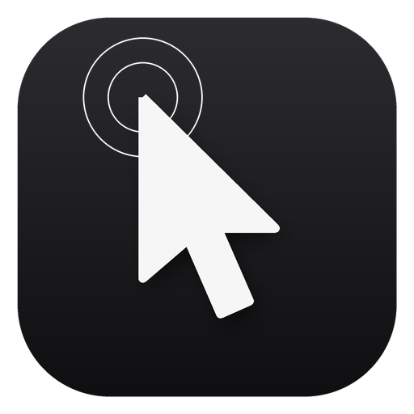

<div align="center">



# HandMouse

Control your Windows cursor with your hand, using only a webcam.

[](https://github.com/YOUR_USERNAME/handmouse/actions/workflows/ci.yml)


</div>

<!--
  Add screenshots taken on your PC to docs/screenshots/, then uncomment:

  <p align="center"></p>
  <p align="center">
    
    
  </p>
-->

HandMouse tracks one hand through your webcam and turns it into mouse input: move, click, drag, right-click and scroll.
Everything runs on your computer. Nothing is recorded or sent anywhere.

## Highlights

- **Quiet, native-feeling interface.** Dark and light themes, a monochrome default with optional accent colours, a live camera preview, and settings that save themselves.
- **Clicks that land where you pointed.** The cursor holds still the moment a pinch begins, and a short hysteresis band stops pinches from flickering.
- **Fully adjustable.** Switch any gesture off, pick a profile, and tune smoothing, active zone, pinch sensitivity, drag delay, scroll speed and pause timing.
- **Always interruptible.** With your hand out of view HandMouse does not touch the mouse. A held fist pauses it, and pushing the real mouse into a screen corner stops it.
- **Works at any distance.** Gestures are measured relative to your hand size, not in pixels.

## Gestures

Hold one hand up, palm towards the camera, inside the outlined active zone.

| Gesture | Action |
|---|---|
| Index finger up, other fingers folded | Move the cursor |
| Quick pinch: thumb and index finger | Left click. Two quick pinches make a double-click |
| Hold the pinch for 0.3 s, then move | Drag and drop. Release the pinch to drop |
| Pinch: thumb and middle finger | Right click |
| Index and middle finger up, move hand up or down | Scroll |
| Closed fist, held for 1.5 s | Pause, and resume |
| Hand out of view | HandMouse lets go of the mouse |

Each gesture can be switched off on the **Gestures** page.

## Install (Windows 10 / 11)

You need a webcam and **Python 3.9 to 3.12**. MediaPipe does not support Python 3.13 or newer yet.

1. Install Python 3.12 from <https://www.python.org/downloads/windows/>. Keep the *py launcher* option ticked.
2. Get the code:
   ```bash
   git clone https://github.com/YOUR_USERNAME/handmouse.git
   cd handmouse
   ```
3. Double-click **`setup.bat`**. It creates a virtual environment, installs the dependencies and adds a HandMouse shortcut to your desktop.
4. Open the shortcut (or `run.bat`) and press **Start tracking**.

<details>
<summary>Manual install and command line</summary>

```bash
python -m venv venv
venv\Scripts\activate            # Linux / macOS: source venv/bin/activate
pip install -r requirements.txt
python -m handmouse              # open the app
python -m handmouse --cli        # run without a window, using saved settings
python -m handmouse --camera 1   # headless, using camera 1
python -m handmouse --reset      # restore default settings
```

The code is plain cross-platform Python (PyAutoGUI) but is built and tested for Windows.
macOS needs Camera and Accessibility permission for your terminal. Linux needs an X11 session.
</details>

| Optional file | Purpose |
|---|---|
| `run_debug.bat` | Starts the app with a console so error messages are visible |
| `start_with_windows.bat` | Starts HandMouse when you sign in |
| `build_exe.bat` | Builds a standalone `dist\HandMouse.exe` with PyInstaller (experimental) |

## Settings

| Setting | Effect |
|---|---|
| Profile (Precise, Balanced, Fast) | One-click presets for smoothing and zone size |
| Smoothing | Higher is steadier, with a little more lag |
| Active zone padding | More padding means a smaller box and less hand travel |
| Pinch sensitivity | Higher registers a pinch from further apart |
| Drag hold time | How long a pinch is held before it becomes a drag |
| Scroll speed, reverse direction | Scroll amount per movement, and its direction |
| Pause hold time | How long to hold a fist to pause or resume |
| Preferred hand | Track only your left or right hand |
| Tracking quality | Fast (default) or Accurate (steadier, more CPU) |
| Camera | Choose another webcam with Scan |
| Appearance | Theme, accent colour, overlay options, sound, keep on top, start tracking on launch |

Shortcuts, with the window focused: `Ctrl+Space` start or stop, `Ctrl+P` pause or resume.
Settings are stored in `%APPDATA%\HandMouse\config.json`.

## Getting good tracking

- Sit 50 to 80 cm from the camera with light falling on your hand, not behind it.
- A plain background helps. Keep your whole hand inside the outlined box.
- Cursor jittery: raise Smoothing or choose Precise. Cursor laggy: lower it or choose Fast.
- Accidental clicks: lower Pinch sensitivity. Clicks not registering: raise it.

## Troubleshooting

| Problem | Fix |
|---|---|
| `setup.bat` cannot find Python | Install Python 3.12 (not 3.13 or newer) with the py launcher, then run it again |
| "Could not open camera" | Close apps that use the webcam, press Scan in Settings, and allow desktop apps under Windows Privacy, Camera |
| Black preview or low frame rate | Improve lighting, set Tracking quality to Fast, or turn the preview off |
| No effect in some programs | Programs running as Administrator ignore normal apps. Run `run.bat` as Administrator |
| Clicks land slightly off | Raise Smoothing and move only your fingertip while pinching |
| Blurry window on a scaled display | Right-click `pythonw.exe`, Properties, Compatibility, High DPI settings, Application |
| Anything else | Run `run_debug.bat` and open an issue with the output |

## How it works

```
webcam -> OpenCV frame -> MediaPipe Hands (21 landmarks)
                              |
                    gestures.analyze()        scale-independent features
                              |
                    GestureController         click vs drag, pause, scroll, smoothing
                              |
                    PyAutoGUI backend  ->  Windows cursor
```

```
handmouse/
  gestures.py    landmarks to features, pure functions        (tested)
  controller.py  gesture state machine, any mouse object      (tested)
  config.py      typed settings, validation, persistence      (tested)
  engine.py      camera and MediaPipe thread, preview, stats
  mouse.py       PyAutoGUI backend and Windows DPI handling
  ui.py          CustomTkinter interface
  theme.py       colours and accents
```

## Development

```bash
pip install -r requirements.txt -r requirements-dev.txt
python -m pytest     # no camera needed
ruff check .
```

See [CONTRIBUTING.md](CONTRIBUTING.md). CI runs lint and tests on Python 3.10 to 3.12. Pushing a `v*` tag builds a Windows `.exe` and attaches it to the release.

## Roadmap

- System tray mode
- Per-gesture sensitivity and custom key bindings
- Two-hand zoom and volume control
- Calibration wizard
- Installer

## Notes

The gesture logic is covered by unit tests and a simulated camera and mouse. How it feels in practice depends on your lighting and webcam, so expect to adjust the sliders once.

## Credits

[MediaPipe](https://developers.google.com/mediapipe), [OpenCV](https://opencv.org), [PyAutoGUI](https://github.com/asweigart/pyautogui) and [CustomTkinter](https://github.com/TomSchimansky/CustomTkinter).

## Licence

[MIT](LICENSE)
